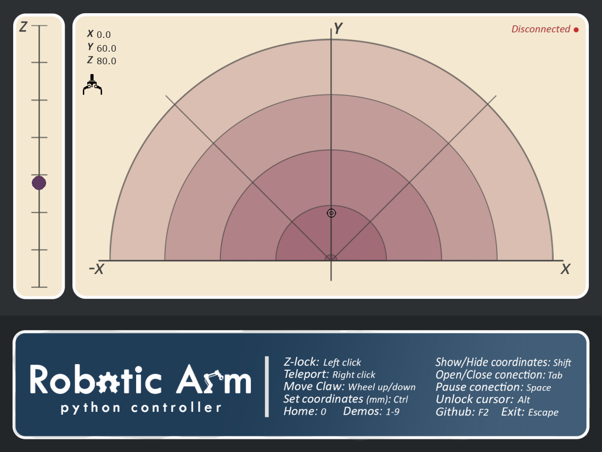

# Robotic Arm Controller

A Python desktop interface that tracks mouse movement to position a robotic arm and control its gripper.

*Interface preview captured with the Arduino disconnected; no commands were sent to a physical arm.*
